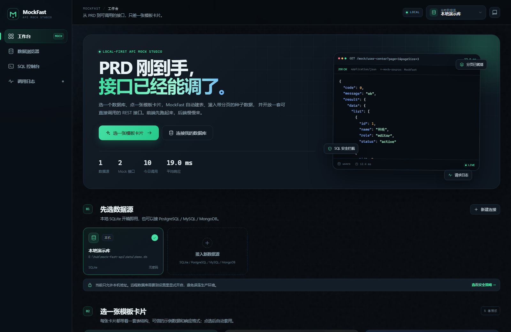
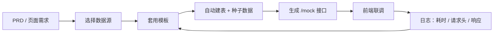
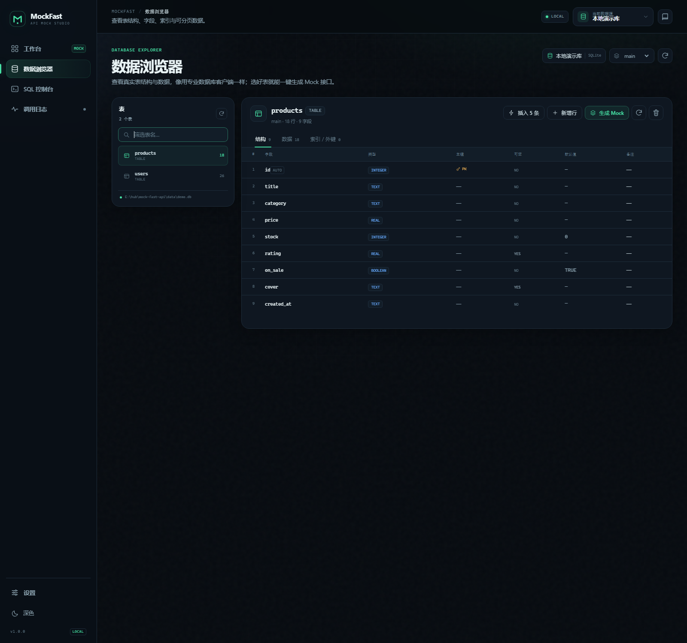
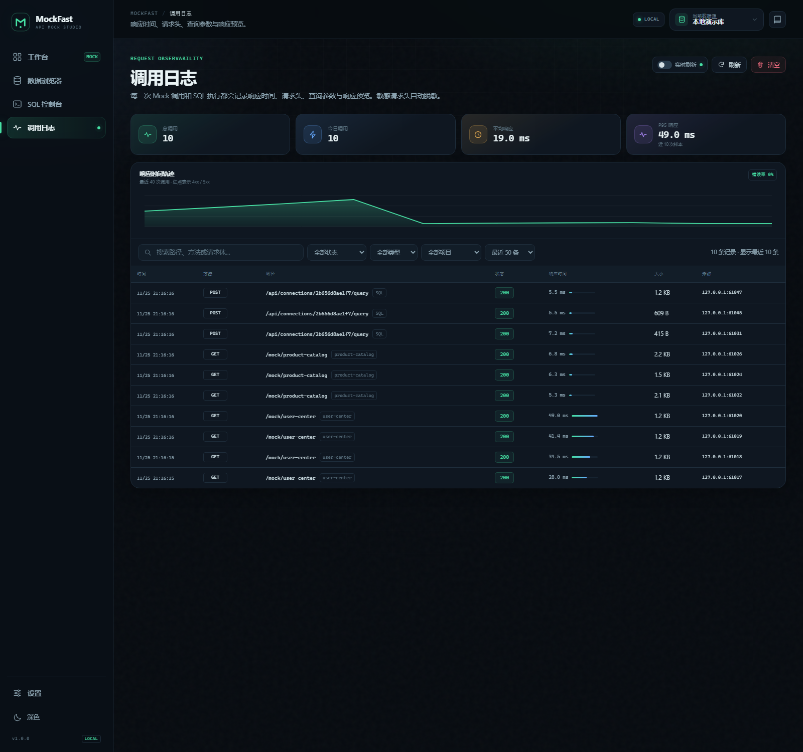

<p align="center">
  
</p>

<h1 align="center">MockFast</h1>

<p align="center">
  <strong>前端先跑起来，后端慢慢来。</strong><br />
  一个本地优先、带数据库浏览器和安全 SQL 控制台的 API Mock 工作室。
</p>

<p align="center">
  <a href="https://github.com/sunlanda/mock-fast-api/actions/workflows/ci.yml"></a>
  
  
  
  
</p>

<p align="center">
  <a href="#-5-分钟上手">5 分钟上手</a> ·
  <a href="#-功能地图">功能地图</a> ·
  <a href="#-接口与响应格式">接口文档</a> ·
  <a href="#-数据库可视化工具调研">技术选型</a> ·
  <a href="#-参与贡献">参与贡献</a>
</p>



---

## 为什么是 MockFast

拿到 PRD，页面已经画完，后端接口却还没出。前端通常只能等，或者临时写一堆散落在代码里的假数据。

MockFast 把「建表 → 造数据 → 生成接口 → 联调 → 看日志」压缩成一个本地页面：

- 选一个数据库（SQLite / PostgreSQL / MySQL / MongoDB）。
- 点一张模板卡片。
- 自动建表、灌入带分页的种子数据、生成一套 REST API。
- 用 `curl` 或前端项目直接调用。
- 在日志页看响应时间和请求头，定位联调问题。
- 需要改数据时，用内置表浏览器或安全 SQL 控制台。

> 适合：前端开发、全栈开发、独立开发者、需要快速做 Demo 的产品/设计同学。
>
> 不适合：生产环境、多人协作数据库、需要审计和权限隔离的团队平台。

---

## 🚀 5 分钟上手

### 第 0 步：准备环境

只需要 **Python 3.10+**。Node.js 只有在你打算改前端源码时才需要。

```bash
python --version
```

> Windows 用户如果 `python` 不在 PATH，请先安装 Python 并勾选 “Add Python to PATH”。

### 第 1 步：启动服务

**Windows（推荐）**

```bat
cd mock-fast-api
run.bat
```

`run.bat` 会自动创建 `.venv`、安装依赖并打开浏览器。

**macOS / Linux**

```bash
cd mock-fast-api
bash run.sh
```

**手动启动（任何系统）**

```bash
python -m venv .venv

# Windows
.venv\Scripts\activate

# macOS / Linux
source .venv/bin/activate

pip install -r requirements.txt
python run.py --open
```

看到下面这行就成功了：

```text
MockFast  →  http://127.0.0.1:8787
API Docs   →  http://127.0.0.1:8787/api/docs
```

> 端口被占用时：`python run.py --port 9000`。

### 第 2 步：认识工作台

打开 `http://127.0.0.1:8787`，你会看到三块内容：

1. **先选数据源**：默认已经内置一个「本地演示库」SQLite，开箱即用。
2. **选一张模板卡片**：用户中心、商品列表、订单管理、文章内容、待办清单。
3. **你的 Mock 接口**：生成后的项目、Base URL 和所有端点。

第一次启动还会自动创建两个演示项目：

| 项目 | 接口 | 响应格式 |
| --- | --- | --- |
| 用户中心 Demo | `/mock/user-center` | `result.data.pagination` |
| 商品列表 Demo | `/mock/product-catalog` | `data.data` |

### 第 3 步：套用一张模板

「用户中心 Demo」和「商品列表 Demo」已经预置好了。为了体验从模板新建的完整流程，点击 **「待办清单」** 卡片（它是全新的表，不会和演示数据冲突）：

| 字段 | 建议值 |
| --- | --- |
| 项目名称 | 待办清单 Mock |
| 数据源 | 本地演示库 |
| 表 / 集合 | todos |
| 接口路径 | todos |
| 种子数据 | 18 条 |
| 响应格式 | `result.data.pagination` |

点击 **「创建并生成接口」**。MockFast 会：

- 如果 `todos` 表不存在，自动建表；
- 写入 18 条中文种子数据；
- 生成列表、详情、新增、更新、删除接口；
- 打开「接口已生成」弹窗，展示可直接复制的 Base URL。

### 第 4 步：调用你的第一个接口

浏览器直接打开：

```text
http://127.0.0.1:8787/mock/todos?page=1&pageSize=3
```

或用命令行：

```bash
curl "http://127.0.0.1:8787/mock/todos?page=1&pageSize=3"
```

PowerShell：

```powershell
Invoke-RestMethod "http://127.0.0.1:8787/mock/todos?page=1&pageSize=3" |
  ConvertTo-Json -Depth 6
```

返回结构：

```json
{
  "code": 0,
  "message": "ok",
  "result": {
    "data": {
      "list": [
        { "id": 1, "title": "对齐登录页错误码", "done": false, "priority": "high" }
      ],
      "pagination": {
        "page": 1,
        "pageSize": 3,
        "total": 18,
        "totalPages": 6
      }
    }
  }
}
```

### 第 5 步：验证分页和快速造数

回到「待办清单 Mock」项目卡片：

- 点击 **「+20 条」**，再请求 `?page=2&pageSize=5`；
- 点击 **「预览」**，查看当前格式下的完整响应；
- 在项目卡片右上角切换响应格式，例如 `data.data`，再次请求。

不用改任何前端代码，就能模拟列表页、无限滚动、筛选和分页。

### 第 6 步：接入自己的 PostgreSQL（可选）

点击 **「新建连接」** → 选择 **PostgreSQL**，填写：

| 字段 | 示例 |
| --- | --- |
| Host | `127.0.0.1` |
| Port | `5432` |
| 数据库名 | `postgres`，或你实际有表的库 |
| 用户名 | `postgres` |
| 密码 | 你的本地密码 |

先点 **「测试连接」**，通过后点 **「保存并使用」**。

然后打开左侧 **「数据浏览器」**：

- 选择 schema（通常是 `public`）；
- 左侧会列出表和行数；
- 点击表查看字段、类型、主键、默认值、索引、外键；
- 点「数据」标签可分页查看、编辑、删除行；
- 点 **「生成 Mock」** 就能把已有表变成接口。

> **常见坑**：默认的 `postgres` 数据库里往往没有业务表。如果 `public` 是空的，去「编辑当前连接」把**数据库名**改成你实际有表的库。

### 第 7 步：用 SQL 控制台

打开左侧 **「SQL 控制台」**，输入：

```sql
SELECT id, title, price, on_sale
FROM products
ORDER BY price DESC
LIMIT 5;
```

按 `Ctrl/⌘ + Enter` 或点「执行」。

再试试：

```sql
DELETE FROM products;
```

会看到红色安全提示：**DELETE 必须带 WHERE 条件**，语句不会到达数据库。

需要建表时，打开「允许 DDL」，执行时还会要求输入 `DDL` 二次确认。`DROP TABLE`、`TRUNCATE` 始终会被拦截。

### 第 8 步：看调用日志

打开左侧 **「调用日志」**：

- 每次 Mock 请求和 SQL 执行都会记录；
- 可以看到响应时间、状态码、请求头、查询参数、请求体、响应头、响应预览；
- 点某一行打开详情，复制 cURL 或响应 JSON；
- 默认开启实时刷新，也可以暂停。

### ✅ 到这里你已经掌握了 80%

- [x] 启动本地 Mock 服务
- [x] 用模板生成一套接口
- [x] 调通分页接口
- [x] 快速造数
- [x] 切换响应格式
- [x] 接入自己的数据库
- [x] 安全地执行 SQL
- [x] 查看调用日志

---

## 🗺️ 功能地图

| 模块 | 能做什么 |
| --- | --- |
| **工作台** | 数据源选择、模板卡片、项目列表、Base URL 复制、快速造数、响应预览 |
| **数据浏览器** | schema / database 切换、表结构、字段、索引、外键、分页数据、行编辑、生成 Mock |
| **SQL 控制台** | 语法高亮、行号、历史、示例、SELECT / DML、高危拦截、DDL 二次确认 |
| **调用日志** | 响应时间、请求头、查询参数、请求体、响应头、响应预览、cURL |
| **设置** | 远程数据库策略、日志保留、深色/浅色主题、运行信息 |
| **Mock API** | 列表、详情、新增、更新、删除，分页/排序/搜索/筛选/延迟，4 种响应格式 |

### 数据源

| 类型 | 默认端口 | 说明 |
| --- | --- | --- |
| SQLite | — | 零配置，文件必须位于项目 `data/` 目录 |
| PostgreSQL | 5432 | 支持 schema、serial / identity、索引、外键 |
| MySQL / MariaDB | 3306 | 支持数据库切换、索引、外键 |
| MongoDB | 27017 | 集合浏览器 + find/aggregate/CRUD 文档查询 |

### 5 张模板卡片

| 模板 | 表 | 字段 | 典型场景 |
| --- | --- | --- | --- |
| 用户中心 | `users` | 8 | 成员管理、权限、头像列表 |
| 商品列表 | `products` | 9 | 电商列表、价格、库存、上下架 |
| 订单管理 | `orders` | 8 | 状态机、支付、渠道筛选 |
| 文章内容 | `articles` | 9 | CMS、资讯流、发布状态 |
| 待办清单 | `todos` | 7 | 任务、优先级、完成进度 |

---

## 🔄 工作原理



后端是 **FastAPI + 各数据库官方/主流驱动**，前端是 **零构建的原生 ES Modules**，没有 npm 打包步骤。运行时只有一个 Python 进程。

---

## 📡 接口与响应格式

以 `/mock/user-center`、表 `users` 为例：

| 方法 | 路径 | 说明 |
| --- | --- | --- |
| `GET` | `/mock/user-center` | 分页列表（短地址） |
| `GET` | `/mock/user-center/users` | 分页列表（显式表名） |
| `GET` | `/mock/user-center/users/1` | 单条详情 |
| `POST` | `/mock/user-center/users` | 新增，JSON body |
| `PATCH` | `/mock/user-center/users/1` | 局部更新 |
| `DELETE` | `/mock/user-center/users/1` | 删除 |
| `GET` | `/mock/user-center/__meta` | 项目元信息、参数说明、格式列表 |

### 列表参数

| 参数 | 默认 | 说明 |
| --- | --- | --- |
| `page` | 1 | 页码 |
| `pageSize` | 10 | 每页条数，最大 200；也接受 `page_size` / `size` / `limit` |
| `_sort` | 主键 | 排序字段 |
| `_order` | `asc` | `asc` / `desc` |
| `_q` | — | 跨文本字段模糊搜索 |
| `_format` | 项目配置 | 临时覆盖响应格式 |
| `_delay` | 0 | 模拟延迟毫秒，最大 3000 |
| 其他字段名 | — | 等值筛选；支持 `field__like` / `__gt` / `__gte` / `__lt` / `__lte` / `__neq` |

示例：

```bash
curl "http://127.0.0.1:8787/mock/user-center?page=2&pageSize=5&_sort=id&_order=desc&status=active"
curl "http://127.0.0.1:8787/mock/user-center?page=1&pageSize=5&_delay=800"
curl -X POST "http://127.0.0.1:8787/mock/user-center/users" \
  -H "Content-Type: application/json" \
  -d '{"name":"新同学","email":"new@mockfast.dev","role":"editor"}'
```

新增时如果漏了 `NOT NULL` 且没有默认值的字段（如 `created_at`），MockFast 会自动补一个合理的 Mock 值，避免第一次调用就失败。

### 4 种响应格式

`result.data.pagination`（默认，适合中后台）：

```json
{
  "code": 0,
  "message": "ok",
  "result": {
    "data": {
      "list": [],
      "pagination": {
        "page": 1,
        "pageSize": 10,
        "total": 24,
        "totalPages": 3
      }
    }
  }
}
```

`data.data`（适合已有 axios 拦截器的项目）：

```json
{
  "code": 200,
  "message": "success",
  "data": {
    "data": [],
    "total": 24,
    "page": 1,
    "pageSize": 10,
    "totalPages": 3
  }
}
```

`data.list`：

```json
{
  "code": 0,
  "message": "ok",
  "data": {
    "list": [],
    "total": 24,
    "page": 1,
    "pageSize": 10,
    "totalPages": 3
  }
}
```

`raw`：列表直接返回数组，详情直接返回对象。

响应头还会带上：

```text
X-Mock-Source / X-Mock-Project / X-Mock-Table / X-Mock-Format
X-Mock-Page / X-Mock-PageSize / X-Mock-Total / X-Mock-TotalPages
```

Mock 接口默认开放 CORS（`Access-Control-Allow-Origin: *`），方便 `localhost:5173` 等开发服务器直接调用。**管理 API 不开放跨域**，只允许同源页面访问。

---

## 🔐 数据源安全策略

**默认只允许本机，远程数据库需要显式解锁，远程连接默认只读。**

| 策略 | 行为 |
| --- | --- |
| 默认 | 仅允许 `localhost` / `127.0.0.1` / `::1` / `host.docker.internal` |
| SQLite | 文件必须位于项目 `data/` 目录内 |
| 远程开关 | 设置页「允许连接远程数据库」，或环境变量 `MOCKFAST_ALLOW_REMOTE_DB=1` |
| 远程连接 | 新建时默认勾选「只读」；可查询、可生成读取接口，拒绝写入/造数/DDL |
| 关闭开关 | 已保存的远程连接也会立即被拒绝 |
| 监听地址 | 默认 `127.0.0.1:8787`，不会自动暴露到局域网 |

> **不要连接生产库。** MockFast 没有登录、权限、审计和备份能力。远程库请使用只读账号，并确认不是生产环境。

| 环境变量 | 默认 | 说明 |
| --- | --- | --- |
| `MOCKFAST_HOST` | `127.0.0.1` | 监听地址 |
| `MOCKFAST_PORT` | `8787` | 端口 |
| `MOCKFAST_DATA_DIR` | `./data` | 元数据与 SQLite 文件目录 |
| `MOCKFAST_ALLOW_REMOTE_DB` | 未设置 | `1` / `0` 强制覆盖远程策略 |

---

## 🛡️ SQL 安全拦截

SQL 编辑器带行号、语法高亮、`Ctrl/⌘ + Enter` 执行、示例和历史（浏览器 localStorage）。

默认拦截：

- `DROP DATABASE / SCHEMA / TABLE`、`TRUNCATE`、`ALTER SYSTEM`
- `DELETE` / `UPDATE` 不带 `WHERE`
- `WHERE 1=1` / `WHERE TRUE` 形式的全表操作
- `GRANT` / `REVOKE`、`CREATE USER / ROLE`
- `COPY`、`LOAD DATA`、`INTO OUTFILE`、`xp_cmdshell`
- `pg_terminate_backend`、`ATTACH / DETACH DATABASE`
- `CREATE FUNCTION / PROCEDURE / TRIGGER / EXTENSION`
- `CALL` / `EXEC` / `MERGE`
- `PRAGMA ... = ...`

DDL（`CREATE TABLE`、`ALTER TABLE ADD COLUMN` 等）默认关闭。打开「允许 DDL」后，执行时仍会二次确认并输入 `DDL`，服务端再次校验令牌。

> 安全守卫用于降低误操作，不是完整 SQL 审计。它基于词法/正则规则，不承诺覆盖所有方言和复杂 CTE；不要把生产库接进来。

MongoDB 的限制：

- `deleteOne/deleteMany`、`updateOne/updateMany` 必须提供非空 `filter`；
- 拦截 `$where`、`$function`、`$accumulator`、`$out`、`$merge`、`drop`；
- 集合必须存在；结果最多 500 条。

---

## 🗄️ 数据浏览器



| 能力 | 说明 |
| --- | --- |
| schema / database | 多 schema（PostgreSQL）、多数据库（MySQL / Mongo）切换 |
| 表结构 | 字段名、类型、主键、可空、默认值、备注、外键 |
| 索引 | 索引名、字段、唯一 / 主键标记 |
| 数据 | 服务端分页、排序、文本搜索、行详情、编辑、删除 |
| 表操作 | 插入 5 条种子、新增行、生成 Mock、清空表（输入表名确认） |
| MongoDB | 采样 60 条文档推断字段；JSON 文档编辑 |

---

## 🧪 调用日志



- 每次 `/mock/**` 调用和 SQL 执行都会记录；
- 响应时间、状态码、响应大小、来源 IP、项目 slug；
- 请求头 / 响应头；`authorization`、`cookie`、`set-cookie`、`x-api-key` 脱敏；
- 查询参数、请求体、响应预览（最多 8KB）；
- 搜索、状态/类型/项目筛选、暂停刷新、清空；
- 点击行打开详情，复制 cURL / 响应 JSON。

日志保留条数可在设置页调整（200–20000），超出后自动清理最旧记录。

---

## 🔎 数据库可视化工具调研

做技术选型时对比了一批常见的开源 / 自托管工具。许可证以各仓库的 `license` 字段为准（2026-11 访问）：

| 工具 | 形态 | 许可证 | 备注 |
| --- | --- | --- | --- |
| [Adminer](https://www.adminer.org/) | 单文件 PHP Web | Apache-2.0 或 GPL-2 | 轻量，支持 MySQL/PostgreSQL/SQLite 等；需要 PHP 运行时和独立登录 |
| [CloudBeaver](https://github.com/dbeaver/cloudbeaver) | Java Web | Apache-2.0 | DBeaver 的 Web 版，能力完整，适合团队部署 |
| [DBGate](https://github.com/dbgate/dbgate) | Node Web / Electron | GPL-3.0 | 支持 MySQL/PostgreSQL/MongoDB/SQLite；Web 版需要单独服务 |
| [SQLPad](https://github.com/sqlpad/sqlpad) | Node Web SQL 编辑器 | MIT | 已归档，偏查询，不是完整 schema 管理器 |
| [NocoDB](https://github.com/nocodb/nocodb) / [Directus](https://github.com/directus/directus) / [Baserow](https://github.com/baserow/baserow) | No-code 平台 | NOASSERTION | 偏 Airtable 式协作/内容管理，不是 SQL Mock 工具 |

### 为什么内置浏览器，而不是 iframe 嵌入

- **运行时成本**：Adminer 需要 PHP，CloudBeaver 需要 Java，DBGate 需要 Node；本地 Mock 工具不应再拉起一套服务。
- **登录与会话**：这些工具有自己的登录态、Cookie、CSP / `X-Frame-Options`，跨端口 iframe 往往需要反向代理或关闭安全头。
- **数据源割裂**：外部工具里配置一遍数据库，MockFast 里还要再配置一遍；连接测试、schema、SQL 守卫、Mock 生成无法共享。
- **安全模型不同**：外部工具是完整数据库管理；MockFast 需要「默认只读 / 高危拦截 / 远程解锁」的收敛策略。
- **许可证**：DBGate 是 GPL-3.0，Adminer 是 Apache-2.0/GPL-2 双轨，部分 no-code 平台是 NOASSERTION；直接打包分发需要逐项确认义务。

所以 MockFast 内置了同源的轻量 schema / 数据浏览器；需要完整表结构编辑、ER 图、导入导出时，可以并行使用 CloudBeaver 或 DBGate。

---

## 🧱 项目结构

```text
mock-fast-api/
├─ app/
│  ├─ main.py                 # FastAPI 入口、静态资源、异常处理
│  ├─ config.py               # 端口、data 目录、远程策略
│  ├─ store.py                # SQLite 元数据：连接/项目/日志/设置
│  ├─ security.py             # SQL 安全守卫
│  ├─ services.py             # 连接、项目、种子、SQL 执行
│  ├─ templates.py            # 5 套模板与种子数据生成器
│  ├─ seed.py                 # 自定义表的通用种子数据
│  ├─ mock_format.py          # 4 种响应外壳 + 端点定义
│  ├─ middleware.py           # Mock CORS + 请求日志
│  ├─ bootstrap.py            # 首次运行演示数据
│  ├─ db/                     # SQLite / PostgreSQL / MySQL / MongoDB 适配器
│  └─ routers/                # connections / schema / projects / sql / logs / mock
├─ web/
│  ├─ index.html
│  ├─ css/style.css
│  └─ js/                     # 无构建步骤的原生 ES Modules
├─ data/                      # 运行时生成：app.db、demo.db
├─ docs/screenshots/
├─ run.py
├─ run.bat / start.ps1 / run.sh
├─ requirements.txt
├─ CONTRIBUTING.md
└─ README.md
```

---

## 📚 API 速查

| 方法 | 路径 | 用途 |
| --- | --- | --- |
| GET | `/api/health` | 健康检查 |
| GET/PUT | `/api/settings` | 远程策略、日志保留、主题 |
| GET/POST | `/api/connections` | 数据源列表 / 新建 |
| POST | `/api/connections/test` | 测试未保存连接 |
| GET | `/api/connections/{id}/schemas` | schema / database 列表 |
| GET | `/api/connections/{id}/tables` | 表 / 集合列表 |
| GET | `/api/connections/{id}/tables/{table}` | 字段、索引、外键 |
| GET/POST | `/.../tables/{table}/rows` | 分页数据 / 新增行 |
| PATCH/DELETE | `/.../tables/{table}/rows/{pk}` | 更新 / 删除 |
| POST | `/.../tables/{table}/seed` | 通用种子数据 |
| POST | `/api/connections/{id}/query` | SQL 控制台 |
| POST | `/api/connections/{id}/mongo/query` | Mongo 文档查询 |
| GET/POST | `/api/projects` | Mock 项目列表 / 创建 |
| POST | `/api/projects/{id}/seed` | 快速追加种子数据 |
| GET | `/api/projects/{id}/preview` | 预览响应 |
| GET | `/api/logs` / `/api/logs/stats` / `/api/logs/{id}` | 日志 |

完整定义：`http://127.0.0.1:8787/api/docs`（OpenAPI / Swagger UI）。

---

## 🧑‍💻 本地开发

```powershell
# 安装依赖
python -m pip install -r requirements.txt

# 启动（热重载）
python run.py --reload

# 前端语法检查（可选，需 Node 20+）
cd web
node --check js/app.js
```

前端没有构建步骤，浏览器直接加载 `web/js/**/*.js` 原生 ES Modules。修改 CSS / JS 后刷新页面即可。

### 常用自测

```bash
# 健康检查
curl http://127.0.0.1:8787/api/health

# 演示接口
curl "http://127.0.0.1:8787/mock/user-center?page=1&pageSize=5"

# 安全拦截
curl -X POST http://127.0.0.1:8787/api/connections/1/query \
  -H "Content-Type: application/json" \
  -d '{"sql":"DROP TABLE users;"}'
```

---

## 🧯 常见问题

### PostgreSQL 连接测试成功，但点进数据浏览器报 500

已修复。原因是 PostgreSQL 适配器执行 `information_schema` 查询时带了 `LIKE 'pg_%'`，而底层曾错误地传入空参数列表，psycopg2 把 `%` 当成占位符，抛出 `IndexError`。现在无参数 SQL 不再传参数列表，schema 查询会正常返回。重启 MockFast 后刷新页面即可。

### PostgreSQL 连接后 `public` 下没有表

默认数据库是 `postgres` 时，`public` 通常没有业务表。到「编辑当前连接」把**数据库名**改成实际有表的库，再刷新数据浏览器；也可以先用 SQL 控制台建一张表验证。

### 端口被占用

```bash
python run.py --port 9000
```

### 远程数据库提示被关闭

到「设置 → 数据源安全策略」开启，或设置环境变量 `MOCKFAST_ALLOW_REMOTE_DB=1`。远程连接默认只读。

### `run.bat` 提示 Python 找不到

安装 Python 3.10+，勾选 “Add Python to PATH”，重新打开终端。或者用 `setup.bat` 手动初始化。

### 页面是旧版本

`Ctrl + F5` 强制刷新。前端没有构建缓存，但浏览器可能缓存了 JS/CSS。

---

## 🤝 参与贡献

欢迎 Issue、文档修正、Bug fix、功能 PR。

**快速流程：**

1. 先开 Issue 描述问题 / 功能（小改动可跳过）。
2. Fork 仓库，从 `main` 切分支：`feat/xxx`、`fix/xxx`、`docs/xxx`。
3. 使用 Conventional Commits 提交，例如 `fix(postgres): pass no params for literal percent queries`。
4. 本地自测：`python -m compileall -q app run.py`，并跑一遍 README 的自测命令。
5. 按 PR 模板填写「改了什么 / 为什么 / 怎么测 / 截图」。
6. 等待 review；合并方式为 Squash merge。

**PR 规范速查：**

| 项目 | 规范 |
| --- | --- |
| 分支 | `feat/`、`fix/`、`docs/`、`refactor/`、`chore/` |
| Commit | `type(scope): summary`，一个 commit 一件事 |
| PR 标题 | `feat(api): 支持自定义响应模板` |
| PR 大小 | 尽量 < 400 行；大改动拆 PR |
| 必须 | 不提交 `data/app.db`、`.venv`、`.acl-reports`、密钥、个人路径 |
| 测试 | 新增/修改行为需说明复现步骤和验证结果 |
| 安全 | 不削弱 SQL 守卫；前端必须转义数据库返回内容 |

完整规范、测试命令、Review checklist 见 **[CONTRIBUTING.md](CONTRIBUTING.md)**。

Bug / 功能请求请使用 [Issue 模板](.github/ISSUE_TEMPLATE)。

CI 会在 PR 上执行 Python 编译、JS 语法检查、启动服务和 Mock API 冒烟测试。

---

## ⚠️ 已知限制

- 单用户、无登录；**不要暴露到公网**。需要多人使用时请自行加反向代理鉴权并限制来源。
- 连接密码以明文保存在本机 `data/app.db`；不会通过 API 回传，但请妥善保护该文件。
- SQL 守卫是规则式拦截，不是完整 SQL 解析器；无法保证覆盖所有方言 / 复杂语句。
- 多语句执行按顺序提交，中途失败时前面的语句可能已生效；重要操作请单条执行。
- MongoDB 的字段是根据样本文档推断的，不是固定 schema；SQL 控制台不支持 Mongo。
- 模板只负责创建表 / 集合和种子数据，不做复杂约束、迁移与 ER 图。
- 日志在本地 SQLite 中，量大时可调低保留条数。

---

## 📄 License

[Apache License 2.0](LICENSE)

---

<p align="center">
  <sub>Built for frontend developers who are tired of waiting for APIs.</sub><br />
  <sub>如果 MockFast 帮到了你，欢迎点一个 ⭐ Star。</sub>
</p>
